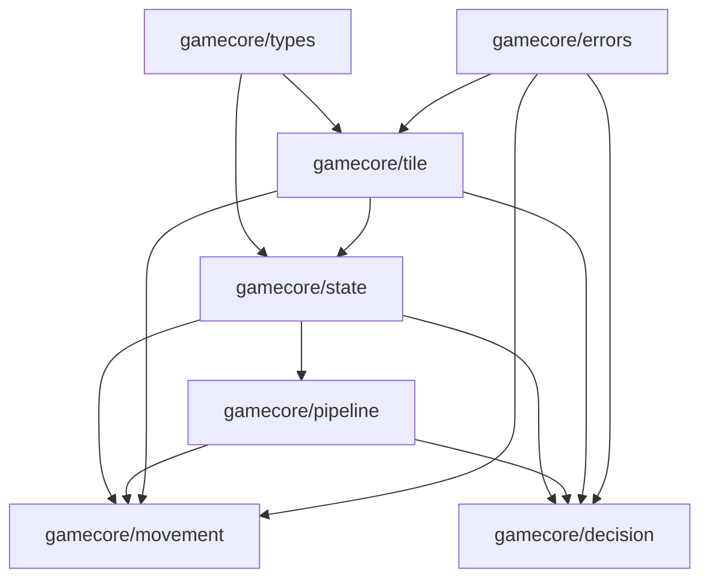

# LandGrab Engine Documentation

Welcome to the technical and domain documentation for the **LandGrab** board game engine.

---

## Documentation Index

1. [**Domain Structs & Architecture (`structs.md`)**](./structs.md)
   - Detailed domain guide to `Game`, `Player`, `Wallet`, `PropertyHolder`, and `Tile`.
   - Explains the **Flyweight Pattern** separating static board definitions from dynamic game state.
   - Explains the $O(1)$ fast ownership resolution via `TileOwnerIndex`.
   - Complete reference for `GamePhase` and `DecisionType` state machines.

2. [**MoveNodes & Movement Pipeline (`movenodes.md`)**](./movenodes.md)
   - Step-by-step breakdown of the linear movement Chain of Responsibility.
   - Complete specifications for `DiceRollNode`, `JailCheckNode`, `PositionUpdateNode`, `GoToJailNode`, `TaxNode`, `PropertyLandingNode`, `RailwayLandingNode`, `UtilityLandingNode`, and `TurnEndNode`.
   - Condition checks (`ShouldExecute`), state mutations (`Execute`), and skip criteria for each node.
   - Incarceration rules, circular board wrap with Go salary ($200), and doubles handling.

3. [**DecisionNodes & Decision Pipeline (`decisionnodes.md`)**](./decisionnodes.md)
   - Step-by-step breakdown of the linear decision Chain of Responsibility.
   - Complete specifications for `TurnValidationNode`, `BuyDecisionNode`, `DeclineBuyDecisionNode`, `BuildHouseDecisionNode`, `SellHouseDecisionNode`, `MortgageDecisionNode`, `DemortgageDecisionNode`, `TradeDecisionNode`, and `PayBailDecisionNode`.
   - Classic board game business rules enforced:
     - **Monopoly Rule**: Must own all properties in a color group before building.
     - **No-Mortgage Rule**: Cannot build if any property in the color group is mortgaged.
     - **Even-Building Rule**: Houses must be built evenly across the color group ($\le 1$ house difference).
     - **Even-Selling Rule**: Houses must be sold evenly across the color group with a 50% refund.
     - **Mortgage Restriction**: Cannot mortgage a property while buildings exist in the color group.
     - **Demortgage Fee**: 10% interest charged when redeeming a mortgaged property.

---

## Package Architecture (Unidirectional DAG)

