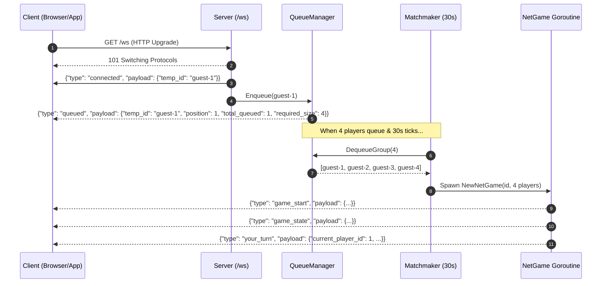

# LandGrab Networking & WebSocket API Reference

This document provides a complete guide to the LandGrab HTTP and WebSocket server architecture, message protocols, matchmaking queue, session management, and lifecycle events.

---

## 1. Overview & Connection Architecture

The LandGrab server allows web, mobile, or desktop clients to connect via WebSocket, enter a global matchmaking queue, and participate in real-time 4-player matches.

### Key Architectural Characteristics
* **Authentication**: **None**. Connections receive an ephemeral guest identifier (`temp_id`, e.g. `guest-1`) upon WebSocket handshake.
* **Match Size**: Exactly **4 players per game**.
* **Matchmaker Cadence**: Runs every **30 seconds** in a background daemon.
* **Queue Invariant**: If 7 players are queued, the matchmaker pops exactly 4 for a match and leaves the remaining 3 for the next 30-second pass.
* **Session Model**: Each match runs in a dedicated goroutine utilizing the **Actor Pattern** (all incoming moves and disconnects are funneled through an action channel).
* **Stateless Engine**: Actions are processed by the stateless `gamecore` flyweight pipelines (`movement.Execute(g)` and `decision.Execute(g)`).

---

## 2. HTTP Endpoints

| Method | Endpoint | Description | Request Body | Response Body |
| :--- | :--- | :--- | :--- | :--- |
| `GET` | `/health` | Liveness and readiness probe for load balancers. | None | `{"status": "ok"}` |
| `GET` | `/status` | Server metrics, queue size, and active game counts. | None | JSON status object |
| `GET` | `/games/{id}` | Read-only state snapshot of an active game session. | None | `GameStatePayload` |
| `GET` | `/ws` | WebSocket upgrade endpoint. | None (WS Handshake) | WebSocket stream |

### 2.1 `/status` Response Example
```json
{
  "status": "healthy",
  "uptime_seconds": 124,
  "queue": {
    "players_waiting": 3
  },
  "active_sessions": {
    "total_games": 2
  }
}
```

### 2.2 `/games/{id}` Response Example
Returns the current `GameStatePayload` JSON structure documented in Section 4.2.

---

## 3. WebSocket Connection Lifecycle



### Reconnection Support
If a player's connection drops and reconnects:
```
GET /ws?reconnect_id=guest-1&game_id=game-1
```
The server reattaches the new WebSocket socket to the existing player slot in the ongoing match and broadcasts the current game state immediately.

---

## 4. WebSocket Message Protocol (JSON)

Every WebSocket message exchanged conforms to a structured JSON envelope.

### 4.1 Client $\to$ Server Actions

Sent as JSON text frames:
```json
{
  "type": "<action_type>",
  "tile_id": 1,
  "to_player_id": 2,
  "cash": 200
}
```

| `type` | Required Payload Fields | When Permitted | Target Gamecore Logic |
| :--- | :--- | :--- | :--- |
| `roll_dice` | *none* | Player's turn, `PhaseReadyToRoll` | Rolls dice, updates position, handles Go pass ($200), and landing effects. |
| `buy_property` | *none* | Player's turn, `PhaseAwaitingDecision` (`DecisionBuy`) | Deducts property cost, transfers ownership to player, and wraps/advances turn. |
| `decline_buy` | *none* | Player's turn, `PhaseAwaitingDecision` (`DecisionBuy`) | Declines purchase and advances turn to next player. |
| `build_house` | `tile_id` (uint) | Player's turn | Verifies monopoly, checks even-building rule, deducts cost, adds house or hotel. |
| `sell_house` | `tile_id` (uint) | Player's turn | Verifies even-selling rule, deducts building, refunds 50% cost. |
| `mortgage` | `tile_id` (uint) | Player's turn | Verifies no buildings in color group, flags mortgaged, credits mortgage value. |
| `demortgage` | `tile_id` (uint) | Player's turn | Verifies property is mortgaged, deducts principal + 10% interest, lifts mortgage. |
| `trade` | `to_player_id` (uint), `tile_id` (uint), `cash` (uint) | Player's turn | Transfers property and cash between active player and counterparty. |
| `pay_bail` | *none* | Player's turn, in jail | Deducts $50 bail, releases player, resumes movement. |

---

### 4.2 Server $\to$ Client Messages

Enveloped as:
```json
{
  "type": "<message_type>",
  "payload": { ... },
  "error": "Error description string if type == 'error'"
}
```

#### `connected`
Sent immediately after WebSocket connection is established.
```json
{
  "type": "connected",
  "payload": {
    "temp_id": "guest-1"
  }
}
```

#### `queued`
Sent when the player is added to the matchmaking lobby.
```json
{
  "type": "queued",
  "payload": {
    "temp_id": "guest-1",
    "position": 1,
    "total_queued": 3,
    "required_size": 4
  }
}
```

#### `game_start`
Sent when a match of 4 players is formed.
```json
{
  "type": "game_start",
  "payload": {
    "game_id": "game-1",
    "assigned_id": 1,
    "temp_id": "guest-1",
    "total_players": 4,
    "starting_money": 1500,
    "players": [
      { "id": 1, "temp_id": "guest-1" },
      { "id": 2, "temp_id": "guest-2" },
      { "id": 3, "temp_id": "guest-3" },
      { "id": 4, "temp_id": "guest-4" }
    ]
  }
}
```

#### `game_state`
Broadcast to all 4 players after every move, roll, or decision.
```json
{
  "type": "game_state",
  "payload": {
    "game_id": "game-1",
    "current_player_id": 1,
    "phase": "ready_to_roll",
    "dice_roll": [3, 4],
    "consecutive_doubles": 0,
    "can_roll_again": false,
    "pending_decision": "none",
    "decision_target_tile": 0,
    "players": [
      {
        "id": 1,
        "temp_id": "guest-1",
        "balance": 1500,
        "position": 7,
        "in_jail": false,
        "is_bankrupt": false,
        "properties": [
          {
            "tile_id": 1,
            "tile_name": "Old Harbor Road",
            "is_mortgaged": false,
            "houses": 1,
            "has_hotel": false
          }
        ]
      }
    ]
  }
}
```

#### `your_turn`
Sent to the active player when their turn begins.
```json
{
  "type": "your_turn",
  "payload": {
    "current_player_id": 1,
    "phase": "ready_to_roll",
    "pending_decision": "none",
    "timeout_seconds": 45
  }
}
```

#### `action_result`
Acknowledges player action execution.
```json
{
  "type": "action_result",
  "payload": {
    "action": "roll_dice",
    "success": true
  }
}
```

#### `error`
Sent when an action is rejected or invalid.
```json
{
  "type": "error",
  "error": "It is currently Player 2's turn"
}
```

#### `player_disconnected`
Broadcast when an opponent drops connection during an active match.
```json
{
  "type": "player_disconnected",
  "payload": {
    "temp_id": "guest-3",
    "player_id": 3
  }
}
```

#### `game_over`
Broadcast when 3 players become bankrupt, leaving a single winner.
```json
{
  "type": "game_over",
  "payload": {
    "game_id": "game-1",
    "winner_id": 1,
    "winner_temp_id": "guest-1"
  }
}
```

---

## 5. Turn Timeouts & Disconnection Policy

* **Turn Timer**: Active players have **45 seconds** to complete their turn.
* **Inactivity Auto-Action**: If the timer expires:
  * In `PhaseReadyToRoll`: Server automatically executes `movement.Execute(g)`.
  * In `PhaseAwaitingDecision`: Server automatically sets `DecisionDeclineBuy` and advances turn.
* **Disconnect during Turn**: If a player disconnects while it is their turn, the server automatically triggers the turn timeout handler to advance the turn and prevent stalled games.
