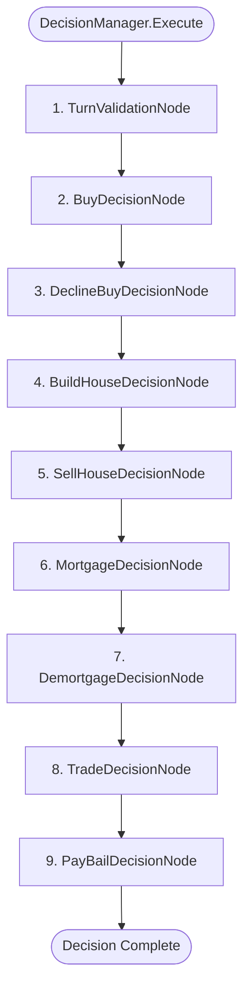

# DecisionNodes & Decision Pipeline Reference

The decision pipeline in LandGrab processes player choices and enforces business rules (monopolies, building rules, mortgages, trading, and bail). Like the movement pipeline, it operates as a **linear Chain of Responsibility** where each node checks `ShouldExecute(g *state.Game) bool`.

---

## 1. Pipeline Execution Flow

---

## 2. Node Specifications & Rules Enforced

### 1. `TurnValidationNode`
**File**: `gamecore/decision/turn_validation_node.go`

#### Domain Responsibility:
Sanity-checks the match state before processing decisions. Ensures an active player exists to prevent nil-pointer dereferences.

* **`ShouldExecute(g)`**: Always returns `true`.
* **Rules Enforced**: Verifies `g.CurrentPlayer() != nil`.
* **Errors**: `ErrNoCurrentPlayer` if no active player exists.

---

### 2. `BuyDecisionNode`
**File**: `gamecore/decision/buy_node.go`

#### Domain Responsibility:
Executes the purchase of the landed property, railway, or utility.

* **`ShouldExecute(g)`**: `g.PendingDecision == state.DecisionBuy`.
* **Rules Enforced**:
  1. Validates tile is purchasable via `targetTile.Cost()`.
  2. Ensures player has sufficient cash via `cp.Wallet.Deduct(cost)`.
* **Execution Logic**:
  1. Deducts cost from player wallet.
  2. Creates and appends a new `PropertyHolder` to `cp.Properties`.
  3. Updates `$O(1)` index: `g.TileOwnerIndex[tileID] = cp.ID`.
  4. Clears pending decision: `PendingDecision = DecisionNone`.
  5. Wraps up turn: If `CanRollAgain` is false, marks `PhaseTurnEnded` and calls `g.AdvanceTurn()`; otherwise sets `PhaseReadyToRoll`.
* **Errors**: `ErrInsufficientFunds`, `tile.ErrNotPurchasable`.

---

### 3. `DeclineBuyDecisionNode`
**File**: `gamecore/decision/buy_node.go`

#### Domain Responsibility:
Handles the player's decision to pass on purchasing the landed property.

* **`ShouldExecute(g)`**: `g.PendingDecision == state.DecisionDeclineBuy`.
* **Execution Logic**:
  1. Clears pending decision: `g.PendingDecision = DecisionNone`.
  2. Wraps up turn: If `CanRollAgain` is false, advances turn to next player; otherwise resets phase to `PhaseReadyToRoll`.
* **Errors**: None.

---

### 4. `BuildHouseDecisionNode`
**File**: `gamecore/decision/build_node.go`

#### Domain Responsibility:
Governs property development (houses and hotels), enforcing classic board game development rules.

* **`ShouldExecute(g)`**: `g.PendingDecision == state.DecisionBuildHouse`.
* **Rules Enforced**:
  1. **Ownership**: Player must own the property (`ErrPropertyNotOwned`).
  2. **Buildable Type**: Non-street properties (Railways, Utilities) cannot be built on (`ErrInvalidDecision`).
  3. **Monopoly Rule**: Player must own *all* properties within that color group (`cp.CountColorGroup(color) == TotalInColorGroup(color)`).
     - Brown / Dark Blue: 2 properties.
     - Light Blue, Pink, Orange, Red, Yellow, Green: 3 properties.
  4. **No-Mortgage Rule**: No property in the color group may be mortgaged. If even one property is mortgaged, all building in that color group is blocked (`ErrMortgagedInGroup`).
  5. **Capacity Rule**: If property already has a Hotel, no further development is allowed (`ErrMaxHousesReached`).
  6. **Even-Building Rule**: Development must be distributed evenly. The player cannot build on a property if its current development level exceeds the minimum development level on any other property in the group (`ErrEvenBuildingRule`).
  7. **Affordability**: Player must have enough cash to cover `CostHouse()` or `CostHotel()`.
* **Execution Logic**:
  - **Upgrading to Hotel** (when current houses == 4): Deducts `CostHotel()`, sets `Hotel = true`, and resets `Houses = 0`.
  - **Adding a House** (when current houses < 4): Deducts `CostHouse()` and increments `Houses++`.
* **Errors**: `ErrPropertyNotOwned`, `ErrInvalidDecision`, `ErrMonopolyRequired`, `ErrMortgagedInGroup`, `ErrEvenBuildingRule`, `ErrMaxHousesReached`, `ErrInsufficientFunds`.

---

### 5. `SellHouseDecisionNode`
**File**: `gamecore/decision/sell_node.go`

#### Domain Responsibility:
Governs liquidating houses and hotels back to the bank for 50% of their original purchase cost.

* **`ShouldExecute(g)`**: `g.PendingDecision == state.DecisionSellHouse`.
* **Rules Enforced**:
  1. **Ownership**: Player must own the property (`ErrPropertyNotOwned`).
  2. **Existence**: Property must have at least 1 house or a hotel (`ErrNoHousesToSell`).
  3. **Even-Selling Rule**: Must sell evenly across the color group. A player cannot sell from a property if another property in the group has more houses (`ErrEvenSellingRule`).
* **Execution Logic**:
  - **Hotel Sale**: Downgrades hotel to 4 houses (`Hotel = false, Houses = 4`) and refunds `CostHotel() / 2` to wallet.
  - **House Sale**: Decrements `Houses--` and refunds `CostHouse() / 2` to wallet.
* **Errors**: `ErrPropertyNotOwned`, `ErrNoHousesToSell`, `ErrEvenSellingRule`.

---

### 6. `MortgageDecisionNode`
**File**: `gamecore/decision/mortgage_node.go`

#### Domain Responsibility:
Handles mortgaging properties to raise immediate cash from the bank.

* **`ShouldExecute(g)`**: `g.PendingDecision == state.DecisionMortgage`.
* **Rules Enforced**:
  1. **Ownership**: Player must own the property (`ErrPropertyNotOwned`).
  2. **Not Already Mortgaged**: Cannot re-mortgage a mortgaged property (`ErrAlreadyMortgaged`).
  3. **No-Buildings Rule**: Cannot mortgage any property in a color group if *any* property in that group currently has houses or a hotel (`ErrBuildingsInGroup`).
* **Execution Logic**:
  1. Sets `targetPH.IsMortgaged = true`.
  2. Credits `targetPH.Tile.MortgageValue()` to the player's wallet.
* **Errors**: `ErrPropertyNotOwned`, `ErrAlreadyMortgaged`, `ErrBuildingsInGroup`.

---

### 7. `DemortgageDecisionNode`
**File**: `gamecore/decision/mortgage_node.go`

#### Domain Responsibility:
Handles lifting a mortgage by paying back the mortgage value plus 10% interest.

* **`ShouldExecute(g)`**: `g.PendingDecision == state.DecisionDemortgage`.
* **Rules Enforced**:
  1. **Ownership**: Player must own the property (`ErrPropertyNotOwned`).
  2. **Mortgaged Status**: Property must currently be mortgaged (`ErrNotMortgaged`).
  3. **Affordability**: Player must have enough cash to cover `DemortgageValue()` ($\text{MortgageValue} + 10\%$).
* **Execution Logic**:
  1. Deducts `targetPH.Tile.DemortgageValue()` from player wallet.
  2. Sets `targetPH.IsMortgaged = false`.
* **Errors**: `ErrPropertyNotOwned`, `ErrNotMortgaged`, `ErrInsufficientFunds`.

---

### 8. `TradeDecisionNode`
**File**: `gamecore/decision/trade_node.go`

#### Domain Responsibility:
Facilitates peer-to-peer trades exchanging property ownership and cash between two players.

* **`ShouldExecute(g)`**: `g.PendingDecision == state.DecisionTrade`.
* **Rules Enforced**:
  1. Trade offer must not be nil (`ErrTradeInvalid`).
  2. Both `FromPlayer` and `ToPlayer` must exist in the game (`ErrTradeInvalid`).
  3. Seller must own the property (`ErrPropertyNotOwned`).
  4. Buyer must have sufficient cash to satisfy the agreed cash transfer (`ErrInsufficientFunds`).
* **Execution Logic**:
  1. Removes `PropertyHolder` from seller's inventory.
  2. Deducts cash from buyer and credits to seller.
  3. Appends `PropertyHolder` to buyer's inventory.
  4. Updates fast index: `g.TileOwnerIndex[tileID] = buyer.ID`.
* **Errors**: `ErrTradeInvalid`, `ErrPropertyNotOwned`, `ErrInsufficientFunds`.

---

### 9. `PayBailDecisionNode`
**File**: `gamecore/decision/bail_node.go`

#### Domain Responsibility:
Allows a player currently in jail to voluntarily pay $50 bail to exit immediately.

* **`ShouldExecute(g)`**: `g.PendingDecision == state.DecisionPayBail`.
* **Rules Enforced**:
  1. Player must be in jail (`ErrPlayerNotInJail`).
  2. Player must have at least $50 (`ErrInsufficientFunds`).
* **Execution Logic**:
  1. Deducts $50 from wallet.
  2. Sets `InJail = false` and resets `JailTurnsServed = 0`.
* **Errors**: `ErrPlayerNotInJail`, `ErrInsufficientFunds`.
