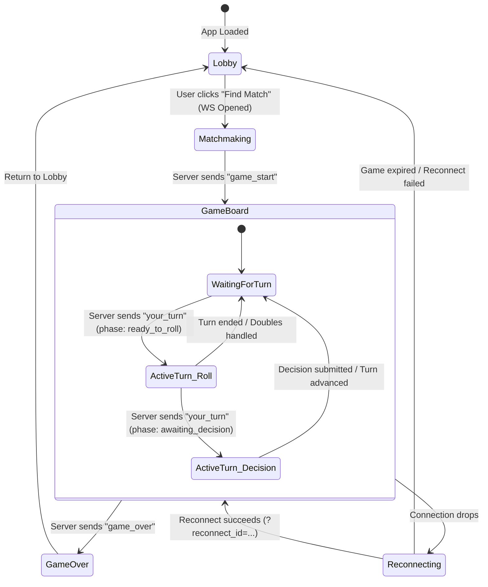

# LandGrab Frontend Integration Guide & Implementation Notes

This document contains architectural notes, state machines, WebSocket message sequences, and component blueprints for developing the LandGrab web frontend (React, Vue, Svelte, or Vanilla TypeScript).

---

## 1. Architecture & Connection Overview

* **Protocol**: WebSocket over `/ws` (with standard JSON text frames).
* **Base URL**:
  * Development: `ws://localhost:8080/ws` (HTTP endpoints at `http://localhost:8080`)
  * Production: `wss://<host>/ws`
* **Authentication**: **None required**. The server assigns an ephemeral UUID `temp_id` (e.g. `guest-1`) upon connection.
* **Match Size**: Exactly **4 players per match**.
* **Matchmaking Cadence**: Matchmaker evaluates the queue every **30 seconds**.
* **Reconnection Support**: `ws://localhost:8080/ws?reconnect_id={temp_id}&game_id={game_id}`.

---

## 2. Frontend State Machine & Screen Flow



---

## 3. Step-by-Step Frontend Integration Flow

### Step 1: Query Server Status (Lobby Screen)
Before establishing a WebSocket connection, query HTTP `/status` to display live server statistics:
```typescript
interface ServerStatus {
  status: string;
  uptime_seconds: number;
  queue: {
    players_waiting: number;
  };
  active_sessions: {
    total_games: number;
  };
}

async function fetchServerStatus(): Promise<ServerStatus> {
  const res = await fetch("http://localhost:8080/status");
  return await res.json();
}
```

---

### Step 2: Connect & Initiate Match Search
When the user clicks **"Find Match"**:
```typescript
let ws: WebSocket;
let myTempID: string = "";
let myAssignedID: number = 0;
let currentGameID: string = "";

function startMatchSearch() {
  ws = new WebSocket("ws://localhost:8080/ws");

  ws.onopen = () => {
    console.log("Connected to LandGrab server");
  };

  ws.onmessage = (event) => {
    const msg = JSON.parse(event.data);
    handleServerMessage(msg);
  };

  ws.onclose = () => {
    console.log("WebSocket disconnected");
  };
}
```

#### Welcome Messages Handled by Client:
1. **`connected`**:
   ```json
   { "type": "connected", "payload": { "temp_id": "guest-1" } }
   ```
   * Action: Save `temp_id` in `sessionStorage.setItem("temp_id", "guest-1")`.
2. **`queued`**:
   ```json
   {
     "type": "queued",
     "payload": {
       "temp_id": "guest-1",
       "position": 1,
       "total_queued": 2,
       "required_size": 4
     }
   }
   ```
   * Action: Transition to **Matchmaking Screen**, display: *"Searching for players... (2/4 in queue)"*.

---

### Step 3: Match Found & Game Initialization
When 4 players are grouped, the server emits two messages in quick succession:

1. **`game_start`**:
   ```json
   {
     "type": "game_start",
     "payload": {
       "game_id": "game-1",
       "assigned_id": 1,
       "temp_id": "guest-1",
       "total_players": 4,
       "starting_money": 1500,
       "players": [
         { "id": 1, "temp_id": "guest-1" },
         { "id": 2, "temp_id": "guest-2" },
         { "id": 3, "temp_id": "guest-3" },
         { "id": 4, "temp_id": "guest-4" }
       ]
     }
   }
   ```
   * Action: Save `myAssignedID = payload.assigned_id`, `currentGameID = payload.game_id`.
   * Save to storage: `sessionStorage.setItem("game_id", payload.game_id)`.

2. **`game_state`**: Full initial board state (all players on tile 0, \$1500 balance).
   * Action: Transition to **GameBoard Screen**, render the 40-tile board and player tokens.

---

### Step 4: Turn Notification & Player Actions

#### A. Receiving Turn Notification (`your_turn`)
When it is the client's turn, the server sends:
```json
{
  "type": "your_turn",
  "payload": {
    "current_player_id": 1,
    "phase": "ready_to_roll",
    "pending_decision": "none",
    "timeout_seconds": 45
  }
}
```
* **UI Action**:
  * Enable the **"Roll Dice"** button.
  * Start a visual 45-second turn countdown timer.

#### B. Submitting Actions to Server
Send JSON text frames via `ws.send(JSON.stringify(payload))`:

```typescript
// 1. Roll Dice
function rollDice() {
  ws.send(JSON.stringify({ type: "roll_dice" }));
}

// 2. Buy Property (when phase === "awaiting_decision" && pending_decision === "buy")
function buyProperty() {
  ws.send(JSON.stringify({ type: "buy_property" }));
}

// 3. Decline Property Purchase
function declineBuy() {
  ws.send(JSON.stringify({ type: "decline_buy" }));
}

// 4. Build House on a Tile
function buildHouse(tileId: number) {
  ws.send(JSON.stringify({ type: "build_house", tile_id: tileId }));
}

// 5. Sell House on a Tile
function sellHouse(tileId: number) {
  ws.send(JSON.stringify({ type: "sell_house", tile_id: tileId }));
}

// 6. Mortgage Property
function mortgageProperty(tileId: number) {
  ws.send(JSON.stringify({ type: "mortgage", tile_id: tileId }));
}

// 7. Demortgage Property
function demortgageProperty(tileId: number) {
  ws.send(JSON.stringify({ type: "demortgage", tile_id: tileId }));
}

// 8. Trade Offer
function proposeTrade(toPlayerId: number, tileId: number, cashAmount: number) {
  ws.send(JSON.stringify({
    type: "trade",
    to_player_id: toPlayerId,
    tile_id: tileId,
    cash: cashAmount
  }));
}

// 9. Pay Bail to Exit Jail ($50)
function payBail() {
  ws.send(JSON.stringify({ type: "pay_bail" }));
}
```

---

### Step 5: Handling Broadcasted State Updates (`game_state`)

After any player moves or acts, **all 4 players** receive an updated `game_state`:

```json
{
  "type": "game_state",
  "payload": {
    "game_id": "game-1",
    "current_player_id": 1,
    "phase": "awaiting_decision",
    "dice_roll": [2, 3],
    "consecutive_doubles": 0,
    "can_roll_again": false,
    "pending_decision": "buy",
    "decision_target_tile": 5,
    "players": [
      {
        "id": 1,
        "temp_id": "guest-1",
        "balance": 1500,
        "position": 5,
        "in_jail": false,
        "is_bankrupt": false,
        "properties": []
      }
    ]
  }
}
```

#### Frontend State Synchronization:
1. Update dice visualization with `payload.dice_roll` (e.g. animate rolling to 2 and 3).
2. Move active player token along the board to `player.position`.
3. Update wallet balances in player scorecards.
4. If `myAssignedID === payload.current_player_id` and `payload.pending_decision === "buy"`:
   * Pop up property modal: *"You landed on [Tile Name] (Cost: $X). Buy or Pass?"* with `[Buy Property]` and `[Decline]` buttons.

---

### Step 6: Disconnection & Seamless Reconnection

If the user refreshes the page or experiences a brief network drop:
```typescript
function tryReconnect() {
  const savedTempID = sessionStorage.getItem("temp_id");
  const savedGameID = sessionStorage.getItem("game_id");

  if (savedTempID && savedGameID) {
    const reconnectURL = `ws://localhost:8080/ws?reconnect_id=${savedTempID}&game_id=${savedGameID}`;
    ws = new WebSocket(reconnectURL);

    ws.onmessage = (event) => {
      const msg = JSON.parse(event.data);
      if (msg.type === "connected") {
        console.log("Successfully reconnected to active match!");
      }
      if (msg.type === "game_state") {
        // Restores full board state immediately
        updateBoard(msg.payload);
      }
    };
  }
}
```

---

### Step 7: Game Over Screen (`game_over`)
When 3 opponents are eliminated by bankruptcy:
```json
{
  "type": "game_over",
  "payload": {
    "game_id": "game-1",
    "winner_id": 1,
    "winner_temp_id": "guest-1"
  }
}
```
* **UI Action**:
  * Display Winner Victory Modal / Banner.
  * Clear `sessionStorage`.
  * Offer `[Return to Lobby]` button.

---

## 4. UI Component Architecture Recommendation

When building the frontend interface, structure the UI into these components:

```
src/
├── components/
│   ├── Board/
│   │   ├── Board.tsx              # 11x11 grid layout for 40 circular tiles
│   │   ├── Tile.tsx               # Renders color bar, name, houses/hotels, owner badge
│   │   └── PlayerToken.tsx        # Colored pawn tokens (Red, Blue, Green, Yellow)
│   ├── Controls/
│   │   ├── ActionPanel.tsx        # Roll Dice button, Buy/Pass buttons, End Turn
│   │   ├── TurnTimer.tsx          # 45-second circular progress bar
│   │   └── DiceDisplay.tsx        # 3D/2D animated dice faces
│   ├── Modals/
│   │   ├── BuyPropertyModal.tsx   # Property purchase decision modal
│   │   ├── ManagePropertyModal.tsx# House build/sell and mortgage actions
│   │   ├── TradeModal.tsx         # Player-to-player trade proposer
│   │   └── GameOverModal.tsx      # Winner celebration overlay
│   └── PlayerList/
│       ├── Scoreboard.tsx         # Player status cards (cash balance, monopolies, in-jail tag)
│       └── LogFeed.tsx            # Real-time activity log ("Player 1 rolled 5 and paid $25 rent")
├── hooks/
│   └── useGameSocket.ts           # Custom WebSocket hook handling connection, queue, and dispatch
└── pages/
    ├── LobbyView.tsx              # Play button, active games counter, rules guide
    └── MatchView.tsx              # Active game view assembling Board + Controls + Scoreboard
```

---

## 5. Tile Index Mapping (Quick Reference for Board Layout)

| Index Range | Side | Tiles Summary |
| :--- | :--- | :--- |
| `0` | Bottom-Right Corner | **Start (Go)** (Collect $200) |
| `1 – 9` | Bottom Row (Right $\to$ Left) | Brown properties, Income Tax, Railways, Light Blue properties |
| `10` | Bottom-Left Corner | **Jail / Just Visiting** |
| `11 – 19` | Left Column (Bottom $\to$ Top) | Pink properties, Power Grid, Orange properties |
| `20` | Top-Left Corner | **Free Parking** |
| `21 – 29` | Top Row (Left $\to$ Right) | Red properties, Railways, Yellow properties, Water Works |
| `30` | Top-Right Corner | **Go To Prison** |
| `31 – 39` | Right Column (Top $\to$ Bottom) | Green properties, Wealth Tax, Dark Blue properties (Celestial Heights) |
