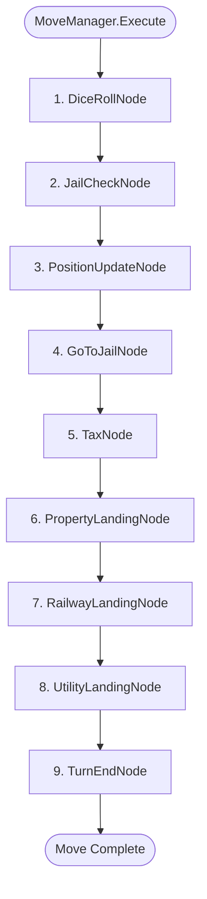

# MoveNodes & Movement Pipeline Reference

The movement pipeline in LandGrab is implemented as a **linear Chain of Responsibility**. Each node inspects `*state.Game` via its `ShouldExecute(g *state.Game) bool` method. If true, it performs its mutations; otherwise, it skips execution and calls `ExecuteNext(g)`.

---

## 1. Pipeline Execution Flow

---

## 2. Node Specifications

### 1. `DiceRollNode`
**File**: `gamecore/movement/dice_node.go`

#### Domain Responsibility:
Handles random (or test-injected) dice rolling, doubles tracking, and the 3-consecutive-doubles jail penalty.

* **`ShouldExecute(g)`**: `g.Phase == state.PhaseReadyToRoll`.
* **Execution Logic**:
  1. Generates two dice values ($1..6$) via `roller()`, stored in `g.DiceRoll`.
  2. Checks for doubles (`d1 == d2`):
     - **3rd Consecutive Doubles**: If `g.ConsecutiveDoubles == 3`, player is caught speeding!
       - Teleports player to Jail: `Position = 10`, `InJail = true`, `JailTurnsServed = 0`.
       - Clears `ConsecutiveDoubles = 0`, sets `CanRollAgain = false`, and sets `Phase = PhaseTurnEnded`.
     - **1st or 2nd Doubles**: Increments `g.ConsecutiveDoubles++` and flags `g.CanRollAgain = true`.
     - **Not Doubles**: Resets `g.ConsecutiveDoubles = 0` and sets `g.CanRollAgain = false`.
* **Skip Condition**: Player has already rolled or phase is not `PhaseReadyToRoll`.

---

### 2. `JailCheckNode`
**File**: `gamecore/movement/jail_node.go`

#### Domain Responsibility:
Enforces incarceration rules: rolling doubles to exit, tracking 3 turns in jail, and enforcing mandatory $50 bail on the 3rd turn.

* **`ShouldExecute(g)`**: `g.CurrentPlayer().InJail && g.Phase != state.PhaseTurnEnded`.
* **Execution Logic**:
  1. If player rolled doubles:
     - Player is released immediately (`InJail = false`, `JailTurnsServed = 0`).
     - Resets `ConsecutiveDoubles = 0` and `CanRollAgain = false` (Monopoly rule: rolling doubles to escape jail does not grant an extra turn).
     - Continues down the chain to `PositionUpdateNode` using the current roll.
  2. If player did not roll doubles:
     - Increments `JailTurnsServed++`.
     - **Turn 1 or 2**: Player remains in jail. Sets `Phase = PhaseTurnEnded` (cannot move this turn).
     - **Turn 3**: Forced bail!
       - If player has $50: Deducts $50, releases player (`InJail = false`, `JailTurnsServed = 0`), and proceeds to move.
       - If player cannot afford $50: Marks `IsBankrupt = true` and sets `Phase = PhaseTurnEnded`.
* **Skip Condition**: Current player is not in Jail.

---

### 3. `PositionUpdateNode`
**File**: `gamecore/movement/position_node.go`

#### Domain Responsibility:
Calculates physical board advancement with circular wrapping ($40$ tiles) and awards the $200 salary when passing or landing on Go.

* **`ShouldExecute(g)`**: `g.Phase != state.PhaseTurnEnded && !g.CurrentPlayer().InJail`.
* **Execution Logic**:
  1. Computes `newPos = cp.Position + rollSum`.
  2. **Pass Go Check**: If `newPos >= 40`, player has passed or landed on Go $\to$ credits `$200` to `cp.Wallet`.
  3. Updates position: `cp.Position = newPos % 40`.
* **Skip Condition**: Turn has ended prematurely (e.g. 3-doubles penalty or stayed in jail).

---

### 4. `GoToJailNode`
**File**: `gamecore/movement/special_nodes.go`

#### Domain Responsibility:
Detects when a player lands on tile #30 ("Go To Prison") and arrests them.

* **`ShouldExecute(g)`**: `cp.Position == 30 && g.Phase != state.PhaseTurnEnded`.
* **Execution Logic**:
  1. Teleports player to position 10.
  2. Sets `InJail = true` and resets `JailTurnsServed = 0`.
  3. Clears doubles and extra turns (`ConsecutiveDoubles = 0`, `CanRollAgain = false`).
  4. Ends movement phase: `Phase = PhaseTurnEnded`.
* **Skip Condition**: Player did not land on tile #30.

---

### 5. `TaxNode`
**File**: `gamecore/movement/special_nodes.go`

#### Domain Responsibility:
Enforces mandatory government tax deductions when landing on tax spaces:
* **Income Tax** (Tile #4): $200
* **Wealth Tax** (Tile #38): $100

* **`ShouldExecute(g)`**: `(cp.Position == 4 || cp.Position == 38) && g.Phase != state.PhaseTurnEnded`.
* **Execution Logic**:
  1. Determines tax amount based on position ($200 or $100).
  2. Attempts to deduct tax from `cp.Wallet`:
     - If sufficient funds: Deducts cash.
     - If insufficient funds: Marks `cp.IsBankrupt = true` and sets `Phase = PhaseTurnEnded`.
* **Skip Condition**: Player is not on tile #4 or #38.

---

### 6. `PropertyLandingNode`
**File**: `gamecore/movement/landing_nodes.go`

#### Domain Responsibility:
Handles landing on street properties (brown through dark blue). Resolves ownership, prompts purchase, or executes dynamic rent transfers.

* **`ShouldExecute(g)`**: `g.CurrentTile().Buildable() && g.Phase != state.PhaseTurnEnded`.
* **Execution Logic**:
  1. Queries ownership via `g.GetPropertyOwner(tile.ID())`:
     - **Unowned**:
       - Transitions `Phase = PhaseAwaitingDecision`.
       - Sets `PendingDecision = DecisionBuy` and `DecisionTargetTile = tile.ID()`.
       - Pauses turn progression waiting for player choice.
     - **Self-Owned**: No action required (skip).
     - **Opponent-Owned**:
       - Calls `ph.CalculateRent(dice1, dice2, owner.CountRailways(), owner.CountUtilities())`.
       - If rent $> 0$: transfers funds from active player to owner. If player cannot cover rent, transfers all remaining cash, marks player `IsBankrupt = true`, and sets `Phase = PhaseTurnEnded`.
* **Skip Condition**: Tile is not a street property.

---

### 7. `RailwayLandingNode`
**File**: `gamecore/movement/landing_nodes.go`

#### Domain Responsibility:
Handles landing on railways (tiles 5, 15, 25, 35). Evaluates rent based on the number of railways owned by the landlord ($25 \to $50 \to $100 \to $200).

* **`ShouldExecute(g)`**: `state.IsRailway(g.CurrentTile()) && g.Phase != state.PhaseTurnEnded`.
* **Execution Logic**:
  1. If unowned: prompts `DecisionBuy`.
  2. If opponent-owned: calculates rent using `owner.CountRailways()`, transfers funds, and enforces solvency.
* **Skip Condition**: Tile is not a railway.

---

### 8. `UtilityLandingNode`
**File**: `gamecore/movement/landing_nodes.go`

#### Domain Responsibility:
Handles landing on utilities (Power Grid, Water Works). Evaluates rent dynamically as a multiplier of the dice roll ($4\times$ or $10\times$).

* **`ShouldExecute(g)`**: `state.IsUtility(g.CurrentTile()) && g.Phase != state.PhaseTurnEnded`.
* **Execution Logic**:
  1. If unowned: prompts `DecisionBuy`.
  2. If opponent-owned: calculates rent as `diceSum * 4` (1 utility owned) or `diceSum * 10` (2 utilities owned), and transfers funds.
* **Skip Condition**: Tile is not a utility.

---

### 9. `TurnEndNode`
**File**: `gamecore/movement/turn_end_node.go`

#### Domain Responsibility:
Concludes the movement pipeline or prepares the game state for an extra turn.

* **`ShouldExecute(g)`**: `g.Phase != state.PhaseAwaitingDecision`.
* **Execution Logic**:
  - If `g.CanRollAgain == true`: Sets `Phase = PhaseReadyToRoll` (keeps the turn with the active player).
  - If `g.CanRollAgain == false`: Sets `Phase = PhaseTurnEnded` and calls `g.AdvanceTurn()` to pass the turn to the next player.
* **Skip Condition**: Waiting for a player decision (e.g. buying a property).
