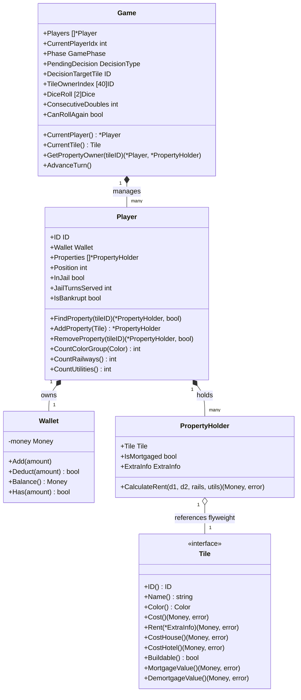

# Domain Structs & Architecture Reference

This document provides a domain-specific guide to all core structs, models, and enums in the LandGrab engine, detailing their responsibilities, relationships, and design rationales.

---

## 1. Architectural Overview

---

## 2. Core Structs & Responsibilities

### `state.Game`
**Location**: `gamecore/state/game.go`

`Game` is the root orchestrator and single source of truth for the entire match. It encapsulates board state, turn ordering, and movement context.

#### Responsibilities:
1. **Turn & Phase Management**: Tracks whose turn it is (`CurrentPlayerIdx`), current game phase (`GamePhase`), and whether doubles were rolled (`CanRollAgain`, `ConsecutiveDoubles`).
2. **Decision State Machine**: Holds `PendingDecision` and `DecisionTargetTile` when a turn pauses for user input (e.g. buying a property, building, mortgaging).
3. **$O(1)$ Ownership Fast Lookup**: Maintains `TileOwnerIndex [40]types.ID`. Instead of searching through every player's inventory, the game resolves tile owners in constant time.
4. **Turn Advancement**: Provides `AdvanceTurn()` to wrap to the next active player and reset turn flags.

#### Key Methods:
* `CurrentPlayer() *Player`: Returns the active player or `nil`.
* `CurrentTile() tile.Tile`: Returns the immutable flyweight tile corresponding to the active player's position.
* `GetPropertyOwner(tileID types.ID) (*Player, *PropertyHolder)`: Instantly resolves both the owner player pointer and the specific `PropertyHolder` for a tile.
* `AdvanceTurn()`: Cycles `CurrentPlayerIdx`, resets doubles, and transitions `Phase` to `PhaseReadyToRoll`.

---

### `state.Player`
**Location**: `gamecore/state/player.go`

`Player` represents an individual participant in the game.

#### Responsibilities:
1. **Identity & Location**: Stores player `ID` and physical board `Position` ($0..39$).
2. **Financial Management**: Owns an encapsulated `Wallet`.
3. **Property Inventory**: Stores an array of `*PropertyHolder` instances representing properties currently owned.
4. **Incarceration Tracking**: Tracks `InJail` status and `JailTurnsServed` (for the 3-turn jail rule).
5. **Solvency Tracking**: Tracks `IsBankrupt` flag.
6. **Set & Monopoly Counting**: Provides helper methods to count owned properties by color group, railways, and utilities.

#### Key Methods:
* `FindProperty(tileID types.ID) (*PropertyHolder, bool)`: Locates an owned property by tile ID.
* `AddProperty(t tile.Tile) *PropertyHolder`: Wraps a tile into a new `PropertyHolder` and adds it to inventory.
* `RemoveProperty(tileID types.ID) (*PropertyHolder, bool)`: Removes a property from inventory (used during trades).
* `CountColorGroup(color tile.Color) int`: Counts properties owned in a given color group (used for monopoly validation).
* `CountRailways() int`: Counts owned railway tiles (used for railway rent scaling).
* `CountUtilities() int`: Counts owned utility tiles (used for utility multiplier selection).

---

### `state.Wallet`
**Location**: `gamecore/state/player.go`

Encapsulates currency operations and safeguards against negative balances.

#### Responsibilities:
1. **Balance Maintenance**: Tracks non-negative cash reserves (`types.Money`).
2. **Safe Debiting**: `Deduct(amount)` only succeeds if the wallet has sufficient funds, returning `false` if unaffordable.
3. **Affordability Inquiries**: `Has(amount)` checks if a purchase or fee can be covered.

---

### `state.PropertyHolder`
**Location**: `gamecore/state/property_holder.go`

`PropertyHolder` acts as the **runtime bridge between the immutable flyweight `Tile` and mutable game state**.

#### Why PropertyHolder Exists:
* The 40 tiles on the board are shared flyweights (`tile.TileAt(pos)` returns an immutable singleton).
* Runtime games have dynamic state that varies per match: *Is this property mortgaged? How many houses are built?*
* `PropertyHolder` bundles the static flyweight tile with its dynamic state: `IsMortgaged` and `tile.ExtraInfo`.

#### Responsibilities:
1. **State Preservation**: Stores `IsMortgaged` (`bool`), `Houses` (`int`), and `Hotel` (`bool`).
2. **Rent Calculation Dispatch**: Implements `CalculateRent(dice1, dice2, railwaysOwned, utilitiesOwned)`:
   - Returns `$0` if `IsMortgaged == true`.
   - Packages dynamic parameters into `tile.ExtraInfo`.
   - Calls the underlying tile's `ph.Tile.Rent(&extraInfo)` method.

---

## 3. Flyweight Tiles (`tile.Tile`)
**Location**: `gamecore/tile/`

Tiles are immutable singletons created at package initialization. They define static game rules and tables:
* **`property`**: Defines street properties with name, color group, purchase cost, house/hotel cost, mortgage value, and the 6-tier rent table (Base, 1H, 2H, 3H, 4H, Hotel).
* **`railway`**: Defines railways (Base rent $25, doubling with each railway owned: $25 \to $50 \to $100 \to $200).
* **`utility`**: Defines utilities (Cost $150; rent is $4\times$ dice sum for 1 utility, $10\times$ dice sum for 2 utilities).
* **`normal`**: Defines non-purchasable special tiles (Start, Income Tax, Wealth Tax, Jail, Free Parking, Go To Prison, Fortune/Chance, Community Fund).

---

## 4. Enums & Sentinels

### `GamePhase`
Tracks the high-level turn lifecycle:
* `PhaseReadyToRoll`: Player is at the start of their turn and eligible to roll.
* `PhaseAwaitingDecision`: Movement finished and paused; engine is awaiting a decision (e.g. buy or decline).
* `PhaseTurnEnded`: Movement and decisions complete; ready to advance turn.
* `PhaseGameOver`: Match concluded.

### `DecisionType`
Identifies the action requested or pending:
* `DecisionNone`: No decision pending.
* `DecisionBuy`: Player opts to purchase the landed property.
* `DecisionDeclineBuy`: Player declines purchasing the landed property.
* `DecisionBuildHouse`: Player chooses to build a house/hotel on a property.
* `DecisionSellHouse`: Player chooses to liquidate a house/hotel back to the bank.
* `DecisionMortgage`: Player chooses to mortgage a property for cash.
* `DecisionDemortgage`: Player chooses to lift a mortgage by paying principal + 10% interest.
* `DecisionTrade`: Player executes a property/cash trade with another player.
* `DecisionPayBail`: Player pays $50 to exit jail immediately.

### `NoOwnerID`
`const NoOwnerID types.ID = ^types.ID(0)`: Represents an unowned tile in `Game.TileOwnerIndex`.
