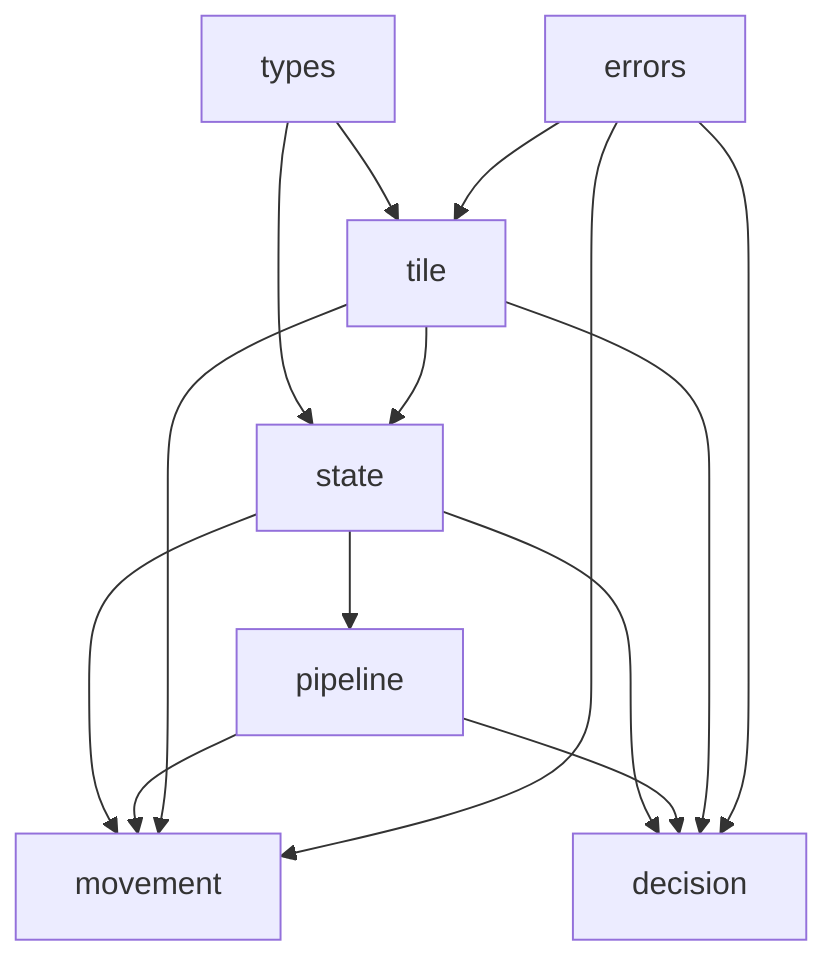

# Architectural Decisions & Design Patterns

This document captures the rationale behind the architectural choices in LandGrab to ensure consistency across sessions and prevent regressions.

---

## 1. The Flyweight Pattern (`Tile` vs. `PropertyHolder`)

### The Problem:
A board game has static rules that never change (a property always costs the same, has the same base rent, same name, same color). However, individual games have mutable state (who owns it, how many houses are built, is it mortgaged). Duplicating static rules across every player or game wastes memory and pollutes state objects.

### The Solution:
* **Static Flyweights (`gamecore/tile`)**: All 40 tiles are immutable singletons initialized once in `board.go`. Lookups like `tile.TileAt(pos)` return this shared instance.
* **Dynamic State (`state.PropertyHolder`)**: When a player buys a property, a `PropertyHolder` is created:
  ```go
  type PropertyHolder struct {
      Tile        tile.Tile      // Shared Flyweight
      IsMortgaged bool           // Runtime mortgage flag
      ExtraInfo   tile.ExtraInfo // Runtime houses, hotel, context
  }
  ```
* **Dispatch**: `ph.CalculateRent(...)` forwards `ph.ExtraInfo` into the flyweight's `ph.Tile.Rent(&extraInfo)` method. If `IsMortgaged` is true, it intercepts and returns `$0`.

---

## 2. Linear Chain of Responsibility with `ShouldExecute`

### Why We Eliminated Router Trees:
Earlier sketches proposed a "Router Node" that forked into sub-chains for Property, Railway, Utility, and Normal tiles. This was rejected because:
1. It introduced unnecessary abstraction and nested trees.
2. A player occupies exactly one tile at a time.
3. Writing clear `ShouldExecute(g *state.Game) bool` conditions on linear nodes makes the pipeline flat, readable, and self-documenting.

### The Standard Node Pattern:
Every node implements the `MoveNode` or `DecisionNode` interface:
```go
type MoveNode interface {
    SetNext(next MoveNode) MoveNode
    ShouldExecute(g *state.Game) bool
    Execute(g *state.Game) error
}
```
If `ShouldExecute` returns `false`, the node seamlessly invokes `b.ExecuteNext(g)`.

---

## 3. Single Mutable Source of Truth (`*state.Game`)

### Why We Removed Context Structs:
We intentionally removed `MoveContext` and `DecisionContext`.
* Instead of copying subset structs around, **a single pointer `*state.Game`** is passed down the entire chain.
* All state (active player, board position, wallet balance, dice rolls, pending decision, phase) lives directly in `Game`.
* Nodes mutate `*state.Game` directly in place, achieving zero allocations during turn execution.

---

## 4. $O(1)$ Fast Ownership Resolution (`TileOwnerIndex`)

### The Problem:
When Player A lands on tile #21, checking whether it is owned—and who owns it—by iterating through every player's property array is $O(\text{players} \times \text{properties})$.

### The Solution:
`Game` maintains a direct array:
```go
TileOwnerIndex [tile.BoardTileCount]types.ID
```
* Unowned tiles hold `NoOwnerID (^types.ID(0))`.
* When a player purchases or trades a tile, `TileOwnerIndex[tileID]` is updated.
* `g.GetPropertyOwner(tileID)` resolves ownership in $O(1)$ time without searching.

---

## 5. 0-Based Contiguous Tile Indexing ($0..39$)

* Position `0` = "Start" (Go).
* Position `1` = "Old Harbor Road".
* Position `39` = "Celestial Heights" (Boardwalk).
* **Benefit**: Tile ID strictly equals array index (`ID == position`). Lookups like `defaultBoard[id]` and `TileOwnerIndex[id]` require zero offsets and zero hashmaps.

---

## 6. Strict Unidirectional Dependency Graph (DAG)

To guarantee zero circular imports in Go:

* `state` never imports `pipeline`, `movement`, or `decision`.
* `movement` and `decision` import `state` to mutate `*state.Game`.
